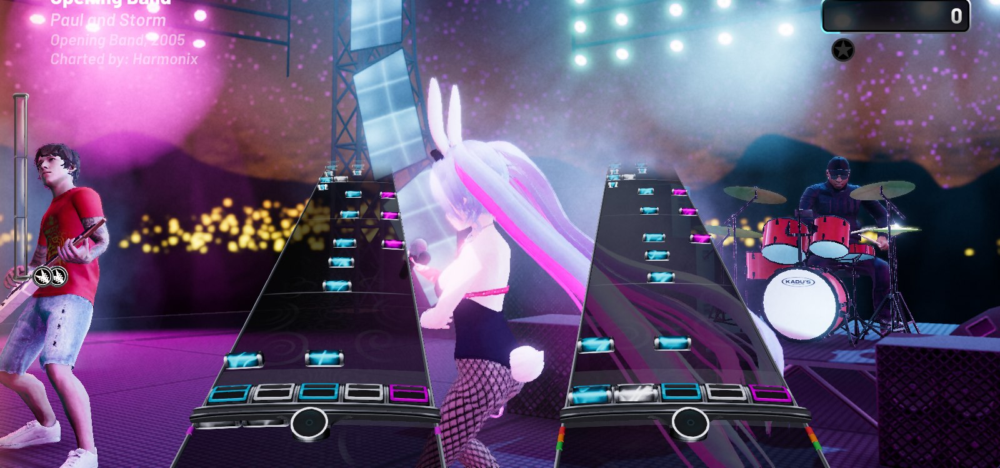
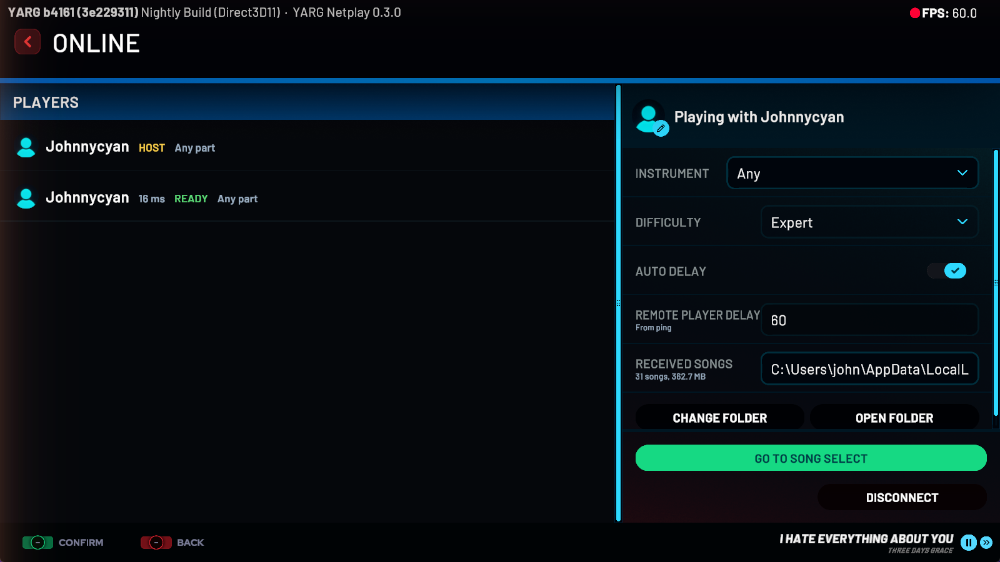
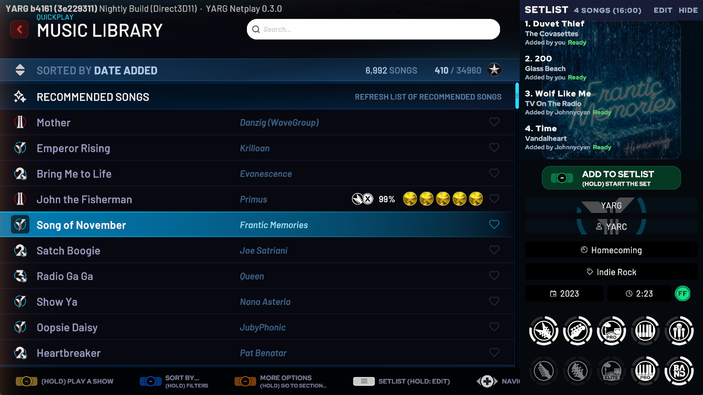
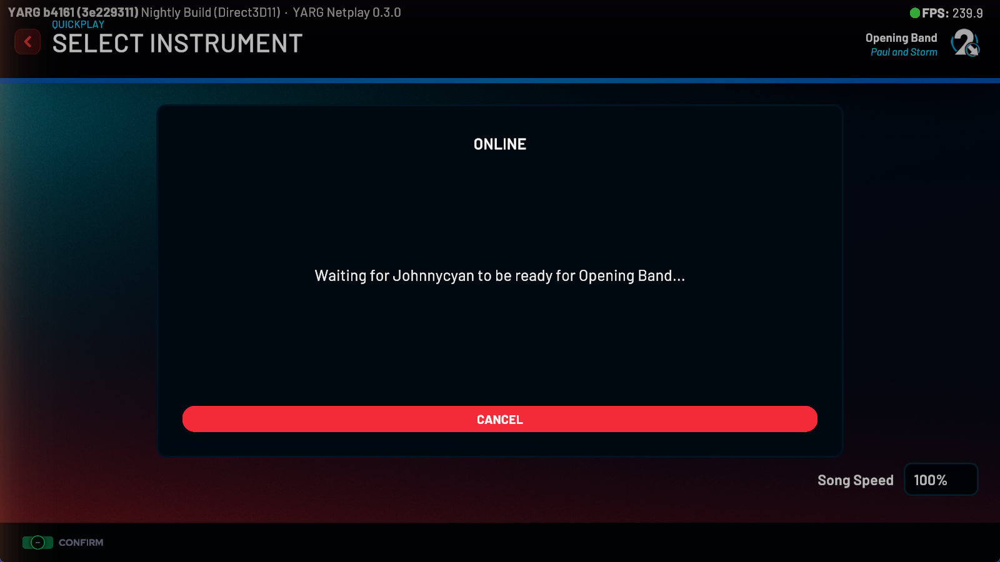

# YARG Netplay

Play [YARG](https://github.com/YARC-Official/YARG) online with friends, up to 8 players. Everyone sees everyone's highway, plays the same songs at the same time, and gets their own score. It's a mod (a BepInEx plugin), so YARG itself isn't changed, and everything happens in YARG's own menus. It's an early version: see [Known limitations](#known-limitations).



## Install

- **Windows:** run this in PowerShell:
  ```powershell
  irm https://github.com/Johnnycyan/YargNetplay/releases/latest/download/install.ps1 | iex
  ```
  Or download [`YargNetplay-Installer.zip`](https://github.com/Johnnycyan/YargNetplay/releases/latest/download/YargNetplay-Installer.zip), extract it and double-click `Install YARG Netplay.bat`.
- **Linux and macOS:** run this in a terminal (Terminal.app on macOS):
  ```bash
  curl -fsSL https://github.com/Johnnycyan/YargNetplay/releases/latest/download/install.sh | bash
  ```
  Then start YARG from the new **YARG (Netplay)** shortcut (Linux) or app in `~/Applications` (macOS). The YARC Launcher's Play button starts YARG without the mod. macOS support hasn't been tested on a Mac yet.

The installer finds the YARG versions you installed with the YARC Launcher, works for both Stable and Nightly, and installs everything the mod needs. When a new version of the mod comes out, YARG tells you on the main menu and can update it for you.

Everyone needs the same YARG version and the same mod version.

## Play together

1. **One player hosts.** In the main menu choose **Online**, then **Host Game**. Press **Copy IP** and send the address to your friends.
2. **The others join.** Choose **Online**, then **Join Address**, and paste the address. It's saved, so next time it's one click. More players can join whenever the host is in the menus, until there are 8.
3. **Pick your part.** Set the instrument and difficulty you plan to play. The music library then only shows songs that have charts for everyone's parts.
4. **Get ready.** Each joining player presses **Ready**, then the host presses **Go to Song Select**, which takes everyone to the music library.

   

5. **Build a setlist together.** Hold Green on a song to add the first one; after that, a single press of Green adds a song (holding it starts the set). Songs anyone adds show up for everyone. If someone adds a song you don't have, it's sent to you automatically.

   

6. **Play.** Start the set (hold Green again) or pick a single song. Each player chooses their own instrument and difficulty. The song starts once everyone is ready, at the same moment on every computer.

   

During a song, pausing, restarting or skipping happens for everyone, and leaving a song asks first because it ends the song for everyone. The other players' highways run a fraction of a second behind, so they show exactly what each player played. Each delay adjusts to that player's connection during the song. If a lag spike holds up someone's inputs, their highway pauses for a moment and then catches up, so their notes are never judged wrong. If a player drops out, the others keep playing.

### If your friends can't connect

- Only the host needs an open port. Everyone else connects to the host, and the host passes everything on. The mod asks your router to open it automatically (UPnP), and the Online page says whether that worked.
- If it didn't, forward port **47820** (TCP and UDP) on the host's router to the host's computer, or use [Tailscale](https://tailscale.com) or [ZeroTier](https://www.zerotier.com) and join with that address instead.
- Some internet providers share one public address between many customers (carrier-grade NAT). Hosting then only works through Tailscale or ZeroTier, or by letting another player host.
- On the same network, use **Copy LAN IP** instead of Copy IP.

### Songs you receive

Songs sent to you are stored in their own folder (shown on the Online page, where you can change it). They're only in your library while you're connected. To keep one, move its `.sng` file into one of your song folders.

## Known limitations

- Up to 8 players, one per computer. Everyone's inputs travel through the host, so two joining players see each other with both of their pings added up.
- Vocals aren't supported yet.
- Band features (band multiplier, unison star power, the fail meter) react to the other players slightly late.
- Rock Band CON songs can't be sent to other players yet.
- After pausing, the games can end up slightly out of sync.

---

# Details

The rest of this page is for the curious and for anyone working on the mod. **F8** opens a small debug overlay in-game.

## How it works

- **Online page:** Main menu > Online opens a full-screen YARG page, built at runtime from YARG's own Profiles page (header, list, sidebar, buttons) and registered with YARG's menu manager, so Back and Escape work like any other page.
  - When not connected, it lists **saved servers** (Join or delete per row; rename with the ✎ icon), plus Host Game, Join Address and Add Server. Servers you join are saved automatically and named after the host's profile. They're stored in `BepInEx\config\yargnetplay-servers.json`.
  - While hosting, **Copy IP** copies your public IP (looked up from api.ipify.org only when you press it) and **Copy LAN IP** copies this PC's address on your local network. The port is added only when it isn't the default.
  - **UPnP:** while hosting, the host asks the router to forward the port (TCP and UDP) to this PC with UPnP, so players outside your network can connect without manual port forwarding. The page shows whether it worked. The forward stays while hosting (players' UDP packets come in through it) and is removed when the session ends and when YARG quits; it also has a 1-hour lease, renewed while hosting, so one left behind by a crash expires. If the router has UPnP turned off, forward the port by hand. Only the host needs this; the joining player connects out.
  - When hosting or connected, it lists the players with ping and Ready state. A joining player's ping is their round trip through the host. Joining players have a Ready button. The host's **Go to Song Select** unlocks once every joining player is ready (or already in song select) and sends everyone to Quickplay.
  - While hosting, **Copy IP** stays available after players have joined, so more can be invited at any time. The player list says how many more fit and shows this PC's LAN address for players on your network.
  - If another player is already in song select (for example after someone backed out to change their part), the page shows "in song select" and a **Go to Song Select** button that takes just you there, with no Ready needed.
  - **Preferred part:** pick the instrument and difficulty you plan to play. The instruments offered are the ones your profile's game mode can play, except co-op guitar; vocals aren't supported yet. While connected, the music library only lists songs that have charts for every player's part (for example, Expert Drums and Medium Guitar). The library updates as soon as anyone changes their part, and the player list shows each player's part.
    - The song count shows how many songs match. YARG's own filters still apply on top. Choose "Any" to not filter by your part.
    - Your part is also preselected in difficulty select. It's saved in the plugin config as `PreferredInstrument` and `PreferredDifficulty`.
  - The remote-player delay is set on this page. With **Auto delay** on (the default), each other player's highway starts each song with half the worst round trip their inputs take to reach you (inputs go through the host, so for two joining players that's both of their round trips to the host; each is the worst of the last 30 pings, ignoring pings from the first second after connecting, since they're often much slower), plus 40 ms for frame timing and jitter, at least 50 ms. During the song each delay then follows the lag actually measured for that player: the worst of the last 15 seconds plus 20 ms (between 30 ms and 1 s). The field shows the longest value the next song starts with. With Auto delay off, the field is a fixed delay for everyone.
  - However short the delay, other players' notes are never judged without their inputs: their highway waits for them (see Remote players below).
  - After each song the mod logs, for each other player, the delay it used, how often and how long their highway waited for inputs, and how many inputs arrived late (there shouldn't be any; if there are, it shows a warning toast).
  - The player list says **TCP ONLY** for a player whose UDP packets don't get through (between them and the host, or between you and the host; see Connection).
  - So is the **received songs folder**, shown with its song count and size. **Change Folder** opens YARG's own folder picker. You can also type a path into the field, or clear it to go back to the default. Songs already received move to the new folder, across drives too. The old folder is removed if it ends up empty. **Open Folder** opens the folder in your file manager. The folder can't be changed during a song or while a song is being transferred.
- **Connection:** a star: up to 7 players each connect to the host over direct TCP (default port `47820`; the port is set in `BepInEx\config\com.johnnycyan.yargnetplay.cfg`), and the host passes every message on to whoever it's for, from its network threads so relaying doesn't wait for a game frame. Every message carries who sent it; the host fills that in itself, so nobody can speak for someone else. The host's clock is the reference, synced with ping/pong, and the host shares everyone's ping once a second.
  - Players can join whenever the host is in the menus and not starting a song. Otherwise, or when the game is full or runs another mod version, the joining player is told why and not let in.
  - When a player leaves or drops out, everyone else carries on: they're taken out of the player list, the ready gate stops waiting for them, and their highway stops where it was if a song is playing. When the host leaves, the session ends for everyone.
  - Inputs also go over UDP (the host uses the same port number), relayed by the host like TCP. Over TCP, one lost packet holds up every input after it until it's resent, often by 200 ms or more on a bad connection. Every UDP packet repeats the newest inputs, so a lost one costs nothing. TCP still carries every input as well, so the game also works when UDP doesn't get through, just with TCP's hold-ups.
  - Each player and the host exchange a UDP port and a random token over TCP (the host makes a different token for each player, so it knows who a packet is from), then both send small probe packets until they arrive. That usually gets through both routers even without a port forward; the host's UPnP or manual forward of the UDP port makes it reliable.
- **Shared setlist:** every player browses YARG's own music library. A song anyone adds to the native setlist (hold Play Song) is added to everyone's setlist too. A player who joins later gets the setlist so far from the host. Removing a song or clearing the setlist syncs the same way. Songs are matched by the chart hash YARG already computes (`SongEntry.Hash`).
- **Setlist overlay:** while connected, the music library shows the shared setlist over the album art in the song info panel. It lists every song, who added it, and its sync state: Ready, Checking, Downloading or Sending with a percentage, missing, or a failed transfer with the reason.
  - The header bar sits just above the cover. The list covers the cover only while expanded and never grows past it, so nothing else on the page is covered. Long setlists scroll, and the list jumps to a newly added song.
  - **Editing:** click **Edit** in the header, or hold **Select** on a controller. Each song gets ▲, ▼ and X buttons (move up, move down, remove). With a controller, Up/Down picks a song, Green picks it up so Up/Down move it, Yellow removes it, and Red or Select finish. Changes apply to everyone's setlists, including songs still downloading. Moving songs in YARG's own setlist view (Left/Right) is shared too.
  - Click the header, or press **Select** on a controller (shown as Setlist in the help bar), to collapse it. Collapsed, only the header shows and the artwork is fully visible. The choice is remembered.
  - While the list is expanded, the "added a song" and "Downloaded" toasts are skipped, since the list already shows both. Failed transfers still show a toast.
  - YARG's FPS counter is hidden on this screen while the overlay is shown, since it sits in the same corner. It comes back when you leave.
- **Picking difficulty:** when any player opens difficulty select, for one song or by starting the setlist, everyone else's game opens it too, for the same songs. Each player picks their own instrument, difficulty and modifiers. Backing out of difficulty select takes everyone back to the music library and cancels a pending Ready. The shared setlist is kept; it is only cleared once a setlist's first song actually starts.
- **Starting:** every load of the gameplay scene goes through `GlobalVariables.LoadScene`.
  - The mod holds it with a native "Waiting for … to be ready" dialog until every player is ready for the same song, and the players' setups (serialized `YargProfile` plus engine preset) are exchanged as they confirm.
  - This covers the first song, the setlist's Continue on the score screen, and score-screen restarts.
  - A second start gate holds `GameManager.Update` until every game is loaded, then opens at the same host-clock time on every machine.
  - YARG's song clock can still start late on one machine: it waits out lagging frames, up to a second, and the first frames of a song are often heavy while the venue loads. On the first running frame, each game measures how late its clock started against the agreed time and seeks forward by that amount, so all run on the same timeline. The BepInEx log shows the measured lateness, the timeline origin (it should match on every machine) and a clock check 10 s into each song.
  - Song speed is fixed at 100%.
  - **Restart and Skip** (pause and fail menus) change the song for everyone. The other games show a toast and follow, then all wait at the ready gate and start together as usual. Cancelling that wait leaves the song for everyone.
  - **Leaving a song:** Back to Library (pause or fail menu) asks first, because it ends the song for everyone. The dialog lists Stay (selected) above Leave Song for Up/Down navigation, and Back means Stay. On Leave Song, the other games leave the song right away and return to the music library with a toast, so everyone stays on the same screen.
- **Remote players:** each other player is added to `GameManager.YargPlayers` as a replay-style player (no bindings), in player order, so every game lists them the same way. Its engine is built through the game's own `CreateEngine` using that player's engine preset. Each frame the mod feeds it that player's inputs and updates it at `songTime - delay`, with its own delay. Its note pools are shifted by `delay * noteSpeed` (updated every frame, since the delay changes), so notes reach the strike line when the delayed engine judges them. The scoring engine is deterministic, so this reproduces each player's real result.
  - It never runs past that player's **watermark**: each game sends, every frame, the time its own engine has reached. YARG's engine moves any later input up to its current time, so no input can come before the watermark. When a lag spike holds up a player's packets, their remote engine stops at the watermark and their highway pauses instead of judging notes without their inputs.
  - Delay changes are eased in: the remote player runs at 75% to 125% of song speed until it's back at the target delay.
- **Local player:** every input the local engine accepts (`BasePlayer.OnGameInput`) is sent to everyone, numbered so the TCP and UDP copies are only used once. After each frame its engine time is sent as the watermark.
- **Scores:** the other players' score cards on the score screen are tagged like live players (Full Combo or Cleared), not Replay, and never High Score. Their scores are never written to your score database. Saved replays include every player.
- **Song transfer:** when someone queues a song you don't have, the mod asks for it automatically: from whoever added it, or else from anyone who has it. Transfers between two joining players go through the host. Several songs can download at once, from different players.
  - Loose song folders are packed into a `.sng` on the sender's side. Background videos are left out, since they can be hundreds of MB. Songs that are already `.sng` (or `.yargsong`) are sent as they are. Rock Band CON songs can't be sent yet.
  - Received songs are stored in their own folder, which is not a song folder. By default it's `%USERPROFILE%\AppData\LocalLow\YARC\YARG\NetplaySongs`, and it can be changed on the Online page (saved as `ReceivedSongsFolder` in the plugin config). If the chosen folder is unavailable at startup, for example on an unplugged drive, the default is used for that session. To keep a song, move its `.sng` into one of your song folders. To discard songs, delete them from that folder.
  - Received songs are loaded straight into memory with YARG's own scanner code, so no library rescan is needed, and they are remembered between sessions.
  - While you're connected, received songs appear in the music library like any other song (metadata, previews, sorting), under the folder "Netplay".
  - They're added to YARG's in-memory song list right before it sorts it, so they survive rescans and are never written to `songcache.bin`. They leave the library when you disconnect.
  - Transfers pause while a song is being played, so they don't delay gameplay inputs.

Every private member the mod touches is listed in `src/Game/Accessors.cs` and the patch targets in `src/Game/GameHooks.cs`. Check those first when a YARG update breaks the mod.

## YARG MIDI Fix (installed alongside)

A second, small plugin (`midifix/`, installed to `BepInEx\plugins\YargMidiFix\`) that makes YARG run faster whether or not you play online. Minis, YARG's MIDI input library, asks for the MIDI port count on every input update to notice devices being plugged in. On Windows 11 that call walks the device list and registry each time; in a profile it took about a third of the main thread's time, and removing it nearly doubled the frame rate. The plugin checks the count on a background thread once a second instead, and Minis only runs its own check when the count changed. A newly plugged-in MIDI device can take up to a second to show up. MIDI notes themselves are read on Minis' own threads as before.

It only touches Minis by reflection (`Minis.MidiBackend.OnUpdate` and `_lastPortCount`), so one DLL works on both YARG channels; if Minis changes, it logs a warning and does nothing. It has the same version as the mod and is released, installed and updated with it.

## Installer and updates

The installer downloads the newest YARG Netplay release from GitHub, built for the YARG channel of each install (stable or nightly). It finds the YARG versions installed by the YARC Launcher (it asks which one if there are several, or pass the YARG folder as an argument), downloads BepInEx 5.4.23.6 if it isn't installed yet (checked against its published SHA-256), and copies the plugin into `BepInEx\plugins\YargNetplay\` and the [MIDI fix](#yarg-midi-fix-installed-alongside) into `BepInEx\plugins\YargMidiFix\`. Run it again to update the mod. To install a local build instead, pass `-PluginPath <dll>` (Windows) or set `YARGNETPLAY_DLL=<dll>` (Linux and macOS); a `YargMidiFix.dll` in the same folder is installed too.

- **Native Linux YARG:** BepInEx starts through `run_bepinex.sh`, so the installer adds a "YARG (Netplay)" app shortcut. The YARC Launcher's Play button starts YARG without the mod.
- **macOS:** the installer finds YARC Launcher installs under `~/Library/Application Support/YARC`, installs BepInEx's universal macOS build next to `YARG.app`, and adds a "YARG (Netplay)" app to `~/Applications` that starts YARG through `run_bepinex.sh` (Apple Silicon runs natively). The YARC Launcher's Play button starts YARG without the mod. Not tested on a Mac yet.
- **YARG.exe under Wine or Proton:** the Windows BepInEx is installed. Start YARG with `WINEDLLOVERRIDES="winhttp=n,b"`.

Once the main menu has finished loading, the mod checks GitHub for a newer release and shows a dialog if there is one (turn it off with `CheckForUpdates` in the `[Updates]` section of the config). **Update Now** downloads the release DLL for your YARG channel (Stable or Nightly, baked into each build) and swaps it in for the installed plugin, and does the same for `YargMidiFix.dll` (installing it if it's missing; failing to get it doesn't stop the update); the new version is used after restarting YARG (the dialog offers **Quit YARG**). The running DLL can't be overwritten on Windows, but it can be renamed, so it's moved aside to `YargNetplay.dll.old` and deleted on the next launch (Linux and macOS take the same path). The same DLL runs on every OS, so the update works wherever the installer does. The download is checked (a valid assembly named YargNetplay with the release's version) before it replaces anything. If the update fails, the dialog links the download page and the installers still work.

The mod's version is shown next to YARG's at the top left of the menu. Stable YARG hides that label, so there it shows just the two versions.

## Releases

GitHub Actions (`.github/workflows/build.yml`) builds every push and pull request against the newest YARG stable and nightly releases, one DLL per channel.

- Pushing a `v*` tag (for example `git tag v0.3.0 && git push origin v0.3.0`) builds with that version and publishes a GitHub release with `YargNetplay-Stable.dll`, `YargNetplay-Nightly.dll`, `YargMidiFix.dll`, `YargNetplay-Installer.zip` and the install scripts. The installers and the update check use the latest release.
- Every day the latest release's code is rebuilt against the newest YARG stable and nightly. If a new YARG changes the built DLL, the release's DLL for that channel is replaced. If it no longer builds, an issue labeled `yarg-compat` is opened, and closed again once it builds. Running the workflow by hand does the same check.
- While the newest YARG of a channel needs porting work, set the repository variable `YARG_NIGHTLY_PIN` (or `YARG_STABLE_PIN`) to the YARG tag that works. Pushes and releases then build that channel against it; the daily check still tests the newest version.

Release builds (`dotnet build -c Release`) put `YargNetplay.dll`, `YargMidiFix.dll` and the installers in `dist\`.

## Build

Requires the .NET SDK. By default the build references the YARG nightly install at
`%LOCALAPPDATA%\YARC\YARG Installs\cd3bd653-...\installation`. To use another install:

```bash
dotnet build -c Release -p:YargDir="C:\path\to\YARG"
```

Building `YargNetplay.csproj` also builds the MIDI fix (`midifix\YargMidiFix.csproj`). Shared settings (version, `YargDir`) are in `Directory.Build.props`. If BepInEx is installed in that YARG folder, the build copies the plugins to `BepInEx\plugins\YargNetplay\` and `BepInEx\plugins\YargMidiFix\` automatically.

## Install BepInEx by hand (once per YARG install)

1. Download BepInEx 5.4.x **win_x64** (Mono, not IL2CPP) from the BepInEx GitHub releases.
2. Extract it into the folder that contains `YARG.exe`.
3. Run YARG once so BepInEx creates its folders, then build this project (or copy `YargNetplay.dll` into `BepInEx\plugins\`).
4. Optional: set `[Logging.Console] Enabled = true` in `BepInEx\config\BepInEx.cfg` to see logs.

The YARC Launcher may remove extra files when it updates or verifies YARG. If so, reinstall BepInEx afterwards.

## Test locally (two instances on one PC)

1. Start two (or more) copies of YARG. Each needs one active profile with an assigned input device.
2. In instance A choose **Online > Host Game**. In instance B (and C, ...) choose **Online > Join Address** and enter `127.0.0.1`.
3. In each joining instance press **Ready**, then in instance A press **Go to Song Select**.
4. Add songs to the setlist, or pick one, and choose a difficulty. Both players confirm Ready.

Every player must run the same YARG build and mod version. The window warns when the YARG versions differ.

Two instances on one PC also share YARG's `currentSong.txt` (written for stream overlays when a song loads). Because netplay starts every load at the same moment, the writes can collide. The mod skips a write that fails, so it can't break the song.

Instances on one PC share one library, so none is ever missing a song. To test song transfer locally, start one instance with the environment variable `YARGNETPLAY_IGNORE_LIBRARY=1`. That instance then only "has" songs it has received.

## Not done yet (details)

- **Vocals:** pitch input is a per-frame stream and needs its own handling.
- **More than one local player** per machine.
- **Difficulty check:** the selected difficulty is not yet validated against the chart.
- **Pause/resume** is forwarded both ways, but each side's resume rewind can leave the clocks slightly apart. A re-sync after resume is needed.
- **Band mechanics** (band multiplier, unison star power, fail meter) see each remote player `delay` late.
- **Direct connections between joining players:** everything goes through the host, which adds the host's leg to the ping between two joining players.
- **Tested so far:** two instances on one PC (b3912 nightly), with keyboard input on one side. Connect, queue sync, synced start, pause/resume sync, the delayed remote highway, input relay, the native menus (Online button, dialogs, setlist sync, following into difficulty select, the Ready gate), and song transfer of a loose folder (received, played, and remembered after a restart) all work. On b4161 nightly (its new setlist API), host/join, the shared setlist, playing a setlist with restart and skip from either side, and the score screens (including Continue, and cancelling the wait for the peer) work. Played across two PCs over the internet, to a player in Argentina with an unstable ping, before inputs went over UDP and before the watermark existed: a fixed delay mostly worked, but lag spikes still made inputs late. UDP, the watermark and the adjusting delay haven't been tested yet. Sessions with more than two players (the host relaying between joining players) build against stable and nightly but haven't been tested in-game yet.
- **Networking:** the host's port must be reachable: UPnP opens it automatically on routers that allow it; otherwise forward it by hand, or use Tailscale or ZeroTier. Hosts behind carrier-grade NAT (no public IPv4 of their own) can't be reached this way. UPnP was tested against one router (miniupnpd, IGD 2), opening and removing the forward; a connection from outside the network through it hasn't been tested yet.
